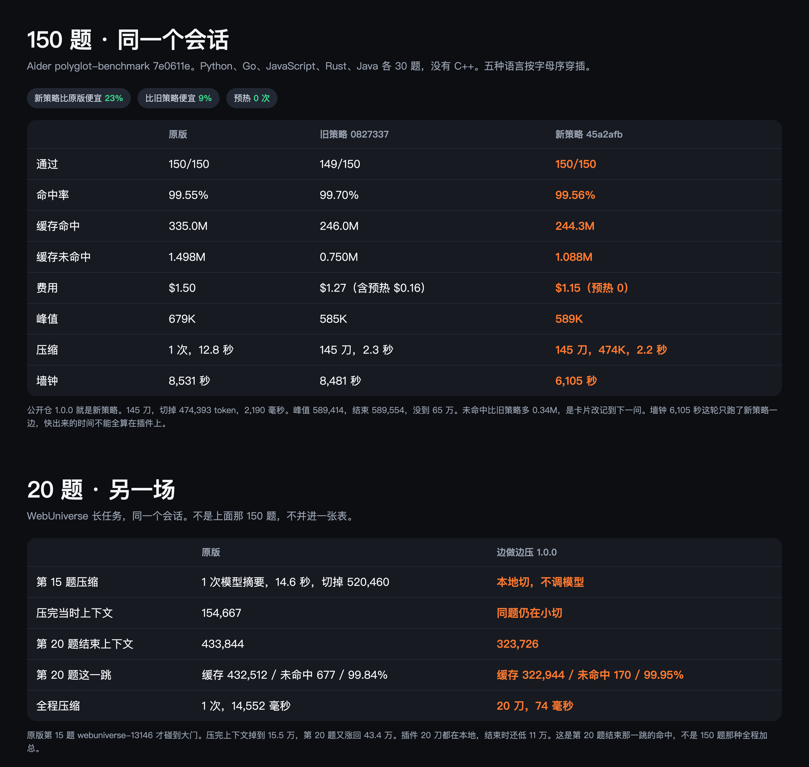

# 边做边压 Live Compact

Live Compact 就是边做边压。活着的时候就压，不等窗口堆满。

DSH 把压缩写死在大约 80%。不到这条线，上下文一直堆。到了才调一次模型，十几秒，还要计费。压完注意力会飘。更麻烦的是，压完没多久又满了。1M 的窗口根本不够用，再压一次更慢。

为什么非要等到 80%？边做边压不行吗？

超过 2 万 token 就切一刀。切的是刚结束的这一轮，不调用模型。切点前面的原文不动，缓存命中还是原来的水准。上下文因此一直被按在较低的位置。雷霆大压缩能拖就拖，拖到尽可能后面。就算哪天满了、真的触发了，掉下来之后小切还在，不会很快又堆回去。

## 两场测评

两场不混在一张表里。



150 题是 Aider `polyglot-benchmark` `7e0611e`，Python、Go、JavaScript、Rust、Java 各 30 题，没有 C++，按字母序穿插在同一个会话里。公开仓这版 150/150 通过，费用 $1.15，预热 0 次，比原版 $1.50 便宜约 23%。命中率 99.56%，和原版 99.55% 同一水准。峰值 589K，没到 65 万。145 刀，2.2 秒，不调模型。墙钟 6,105 秒这轮只跑了插件一边，快出来的时间不能全算在插件上。

20 题是另一场 WebUniverse 长任务。原版第 15 题才大压缩，14.6 秒，切掉 52 万，之后又涨回 43.4 万。插件 20 刀、74 毫秒，结束时上下文 32.4 万，低 11 万。第 20 题那一跳命中率原版 99.84%，插件 99.95%。

## 安装

```sh
dsh plugin --profile web add https://download.merkyorlynn.com/downloads/plugins/dsh-live-compact-1.0.1.tgz
```

和 CLI 一样，也可以先装到本机再看版本：

```sh
npm install -g --force "https://download.merkyorlynn.com/downloads/plugins/dsh-live-compact-1.0.1.tgz"
dsh-live-compact --version
```

需要 DSH `>=0.2.0-rc.2 <0.3.0`。1.0.1 不再引用宿主包未导出的内部函数，干净安装可以激活。装上后跑长任务，日志里出现 `spine cut …ms` 才算这刀生效。页面：https://download.merkyorlynn.com/live-compact.html

DSH-TUI 先不要装。它的预设里还挂着原版压缩，这个包换不掉。

被切掉的原文会明文写到 `~/.dsh/compaction-spine/shadow`，只增不删，要自己清理。

MIT，见 `LICENSE`。
