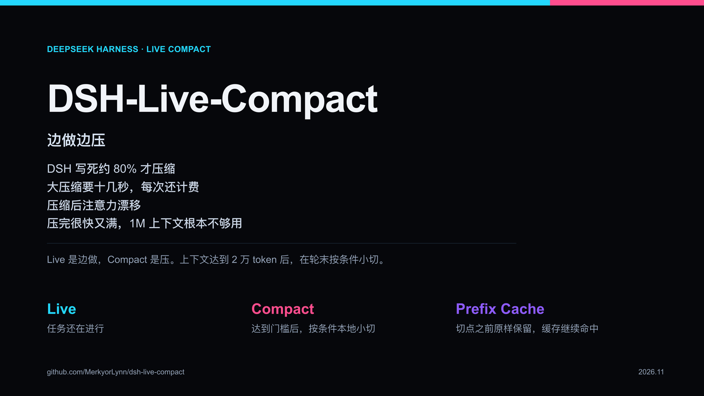
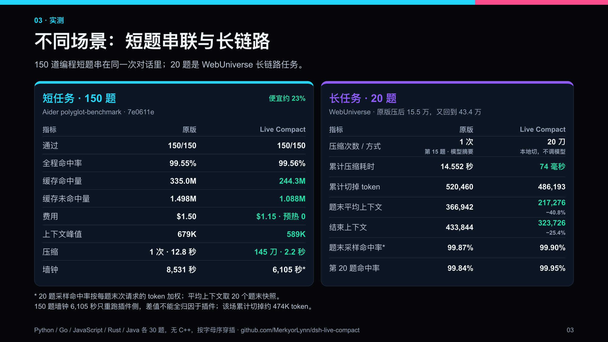
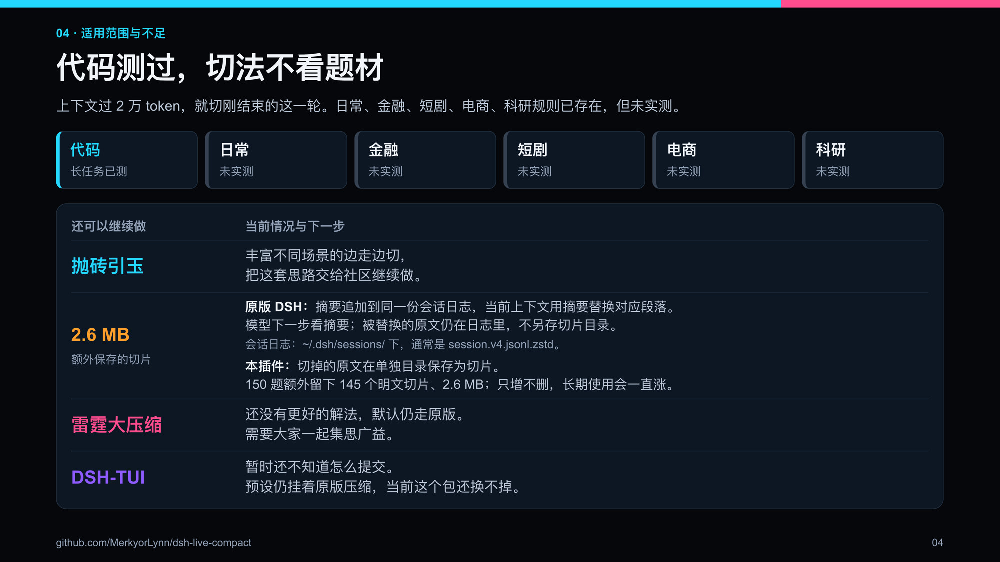
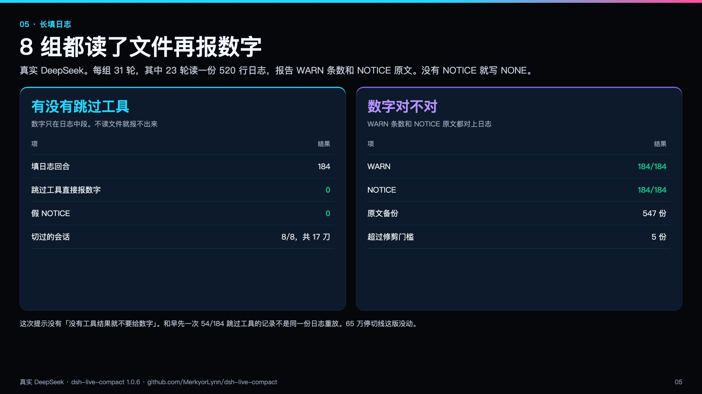
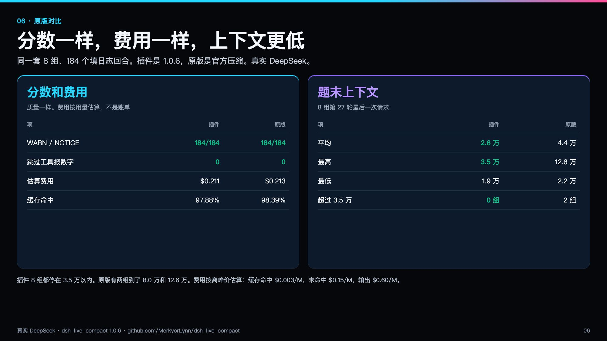

# 边做边压 Live Compact

Live Compact 就是边做边压。活着的时候就压，不等窗口堆满。

DSH 把压缩写死在大约 80%。不到这条线，上下文一直堆。到了才调一次模型，十几秒，还要计费。压完注意力会飘。更麻烦的是，压完没多久又满了。1M 的窗口根本不够用，再压一次更慢。

为什么非要等到 80%？边做边压不行吗？

超过 2 万 token 就切一刀。切的是刚结束的这一轮，不调用模型。切点前面的原文不动，缓存命中还是原来的水准。上下文因此一直被按在较低的位置。雷霆大压缩能拖就拖，拖到尽可能后面。就算哪天满了、真的触发了，掉下来之后小切还在，不会很快又堆回去。




## 两场测评

两场不混在一张表里。150 道是编程短题，串在同一次对话里。20 题是 WebUniverse 长链路。

npm：https://www.npmjs.com/package/dsh-live-compact

GitHub：https://github.com/MerkyorLynn/dsh-live-compact

国内镜像：https://download.merkyorlynn.com/live-compact.html





短题 150 道，Aider `polyglot-benchmark` `7e0611e`。Python、Go、JavaScript、Rust、Java 各 30 题，没有 C++，按字母序穿插。从 `python-affine-cipher`、`go-alphametics`、`javascript-affine-cipher`、`rust-accumulate`、`java-affine-cipher` 往下走。

| | 原版 | Live Compact |
|---|---:|---:|
| 通过 | 150/150 | 150/150 |
| 全程命中率 | 99.55% | 99.56% |
| 缓存命中 | 335.0M | 244.3M |
| 缓存未命中 | 1.498M | 1.088M |
| 费用 | $1.50 | $1.15，预热 0 |
| 上下文峰值 | 679K | 589K |
| 压缩 | 1 次，12.8 秒 | 145 刀，2.2 秒 |
| 墙钟 | 8,531 秒 | 6,105 秒 |

便宜约 23%。145 刀切掉约 474K token。峰值 589,414，结束 589,554，没到 65 万。墙钟 6,105 秒这轮只跑了插件一边，快出来的时间不能全算在插件上。

上面两场是 1.0.2 之前测的。1.0.2 没有重跑 150 题，也没有在真实超过 2 万 token 的会话里切过一刀。

## 失忆对比

1.0.5 对过一次失忆。同一会话、同样任务，真实 DeepSeek。先埋 13 条约束和 1 条报错，再灌 6 轮日志，然后不许读文件，凭记忆答题。每组 2 次，只说明方向。

| | 原版 | Live Compact |
|---|---|---|
| 15 道回忆题 | 15/15，15/15 | 15/15，15/15 |
| 违反约束 | 1 次轻微，0 | 0，0 |
| 日志中段 3 个细节 | 1/3；另一次 3/3，靠解压会话日志，多 10 次工具 | 3/3，3/3，查自己的备份 |
| 每次请求上下文 | 约 15K | 约 29K |

用户说过的约束两边都没忘。差别在工具输出里的细节。总花费在同一个量级。原版这次把摘要阈值调低，保证回忆前做过摘要。

长链路 20 题是另一场。原版第 15 题才做模型摘要，14.552 秒，切掉 520,460。压完上下文掉到 15.5 万，结束时又回到 433,844。插件 20 刀，74 毫秒，切掉 486,193。题末平均上下文 217,276，比原版 366,942 低 40.8%。结束上下文 323,726，比原版低 25.4%。题末采样命中率原版 99.87%，插件 99.90%。第 20 题那一跳原版 99.84%，插件 99.95%。采样命中率按每题末次请求的 token 加权，平均上下文取 20 个题末快照。

## 长填日志

1.0.6 跑了 8 组。每组 31 轮，其中 23 轮读一份 520 行日志，报告 WARN 条数和 NOTICE 原文。没有 NOTICE 就写 NONE。真实 DeepSeek。



| | 结果 |
|---|---:|
| 填日志回合 | 184 |
| 跳过工具直接报数字 | 0 |
| WARN | 184/184 |
| NOTICE | 184/184 |
| 假 NOTICE | 0 |
| 切过的会话 | 8/8，共 17 刀 |

8 组都切过，不是没压缩才碰巧对。这次提示没有「没有工具结果就不要给数字」。和早先一次 54/184 跳过工具的记录不是同一份日志重放。65 万停切线这版没动。

同一套题又跑了原版官方压缩。分数一样，费用一样，上下文更低。跳过工具两边都是 0，WARN 和 NOTICE 都是 184/184。费用按离峰用量估算，插件 $0.211，原版 $0.229，不是账单。题末上下文插件平均 2.6 万、最高 3.5 万；原版平均 4.4 万、最高 12.6 万。插件 8 组都在 3.5 万以内，原版有两组到了 8.0 万和 12.6 万。



## 1.0.6 改了什么

1.0.6 安装地址是新的。1.0.2、1.0.3、1.0.4、1.0.5 的旧包还在原来的链接上。

- 配置报错不再被盖成「服务已被注册」。装不上时能看见原来的原因。
- 备份按会话分目录。卡片只指向这一份文件所在的目录。
- 报错优先进卡片。最近 3 个已经结束的工具轮留在原来的调用和结果里，结果不截短。更早的轮才收成卡片。
- 助手说的「已提交 / 已发布」不进硬行。卡片只记有调用编号的工具事件，不靠词表。
- 后台任务照常切。没结束的登记在卡片上，之后的文件以磁盘为准。失败的 kill 不会被记成已结束。
- 工具原文在官方修剪前按调用编号落盘。卡片给路径、哈希和字节数。写失败就写无完整备份，不留悬空路径。
- 65 万停切线没改。窗口更大时，过了 65 万仍会停掉小切。

## 1.0.5 改了什么

1.0.5 安装地址是新的。1.0.2、1.0.3、1.0.4 的旧包还在原来的链接上。修的是 1.0.4 实测里的五处：

- 预设不再硬等 gate。gate 加载失败时，网页预设不会卡在等待。换包前先试加载，失败就保留原版名字。
- 换上之后带上 0.8、65536、8192。预设里已有的配置优先。
- 预设 id 写在外层或内层都能换。standard、ptc、cordis、minimal 在 0.2.1-rc.5 上都会换。TUI 仍不碰。
- 命令输出只有结构信号才标成报错原文：`isError`、非 0 退出码、`[stderr]`、`[exit code: N]`、`[Command finished with exit code N]`、`exit_code=N`、ptc 结果里的 `"exitCode": N`。证据不够就标状态未知，留原文末尾几行。
- 长输出要先把备份写成功，卡片才指向那个文件。写失败就不切，也不指向一个还不存在的文件。
- 备份写成一个确定的文件，编号不存在共享引擎上。卡片里写这次备份的实际路径。
- 官方工具结果修剪器裁掉的内容不进这份备份。备份上限 128MB。快满时删最老的备份。
- 外壳先加载。引擎装不上时，这一会话不挂起。能改用原版就用原版，并记下「本会话未接管」。原版也装不上时，`/compact` 马上返回错误。
- headless 的宿主包自己关掉了原版压缩。插件不能把那一行重新打开。网页预设不注入 gate，漏换这一轮就继续用原版。

## 1.0.4 改了什么

1.0.4 安装地址是新的。1.0.0 到 1.0.3 的旧包还在原来的链接上。

短的工具结果会留在摘要里，标成工具输出，不标已确认。不超过 12 行、也不超过 512 字，整段留下。更长的只留一行：多少字、正文已省略。省略的原文在本机 `~/.dsh/compaction-spine/shadow`，文件名含这次的短编号。需要再读，不要默认读进来。思考仍不进摘要。

## 1.0.3 改了什么

1.0.3 安装地址是新的。1.0.0、1.0.1、1.0.2 的旧包还在原来的链接上。

摘录只留正文。用户的话和助手写出来的句子按原来的规则留，并标是谁说的。思考和工具结果不进摘要。思考和工具原文进本地备份，带来源。这版不自动读回下一问。

网页和 Desktop 的四个预设在加载时会把组里的原版压缩换成这个包。换不上就落回原版，预设仍能起来。TUI 这版不碰。

- 思考过程不进摘要。本地备份里单独存，标成思考。
- 工具输出不进摘要。`PASS`、文件已更新、目录列表、本机路径、报错头都不留。原文在备份里。
- 留下的每一行标原来是谁说的。句子里写着「用户说」，也不会变成你的新指令。
- 去掉「已确认」。摘要开头写明：这是旧内容摘录，不是新指令，也不是你的授权。
- 这一刀如果没有合格的摘要，就整段留下，不去调模型。卡片可以很短。
- 备份只有自己能读。文件名不带会话号。本机路径不发给模型。备份目录超过 64MB，这一刀不切，旧文件不自动删。
- 2 万和 65 万没动。配置里的 0.8 只管官方大压缩，不管这一刀。想改小切的起点，只能在启动前设 `SPINE_MIN_TOKENS`。

## 安装

从 npm 装（推荐）。headless 和网页/桌面端是两个 profile，用哪个装哪个，两个都用就两条都跑。

headless：

```sh
dsh plugin --profile headless add dsh-live-compact@1.0.6
```

网页和桌面端（共用 web profile，装一次两边都生效）：

```sh
dsh plugin --profile web add dsh-live-compact@1.0.6
```

想先装到本机看版本：

```sh
npm install -g dsh-live-compact
dsh-live-compact --version
```

备用：上不了 npm 的，用国内镜像站的包，同样按 profile 分开装。

headless：

```sh
dsh plugin --profile headless add https://download.merkyorlynn.com/downloads/plugins/dsh-live-compact-1.0.6.tgz
```

网页和桌面端：

```sh
dsh plugin --profile web add https://download.merkyorlynn.com/downloads/plugins/dsh-live-compact-1.0.6.tgz
```

需要 DSH `>=0.2.0-rc.2 <0.3.0`。装上后跑长任务，日志里出现 `spine cut …ms` 才算这刀生效。页面：https://download.merkyorlynn.com/live-compact.html

DSH-TUI 同样换不掉预设里的原版压缩，先不要装。

被切掉的原文会写到 `~/.dsh/compaction-spine/shadow`，只有自己能读。上限 128MB。快满时删最老的备份。

改上限：

```sh
export SPINE_SHADOW_MAX_BYTES=67108864
```

想自己清：

```sh
rm -f ~/.dsh/compaction-spine/shadow/*/*.txt ~/.dsh/compaction-spine/shadow/*.txt
```

设了 `DSH_HOME` 或 `SPINE_SHADOW_DIR` 时，目录在那边。删不掉旧文件时，这一刀不切，同一次会话只警告一次。

MIT，见 `LICENSE`。
